# Adult Income Analysis & Prediction

[](https://www.python.org/downloads/)
[](https://opensource.org)
[](tests/)
[](https://pep8.org/)

An end-to-end data mining and machine learning project exploring socioeconomic patterns, predicting annual income levels, discovering demographic association rules, and performing unsupervised population segmentation on the canonical **UCI Adult Census Income dataset**.

---

## Table of Contents
- [Overview](#overview)
- [Key Features](#key-features)
- [Dataset](#dataset)
- [Project Architecture](#project-architecture)
- [Repository Structure](#repository-structure)
- [Technology Stack](#technology-stack)
- [Installation & Setup](#installation--setup)
- [Running the Project](#running-the-project)
- [Results & Visualizations](#results--visualizations)
- [Data Warehouse & OLAP Operations](#data-warehouse--olap-operations)
- [Machine Learning & Model Evaluation](#machine-learning--model-evaluation)
- [Automated Testing](#automated-testing)
- [Limitations & Future Improvements](#limitations--future-improvements)
- [License & Attribution](#license--attribution)

---

## Overview

Predicting individual income brackets from census microdata is a foundational task in quantitative economics, labor policy, and predictive analytics. Disparities in annual income are driven by complex interactions among educational attainment, capital gains, working hours, occupational roles, and demographic characteristics.

This project delivers a complete data mining pipeline:
1. **Exploratory Data Analysis (EDA):** Deep empirical profiling, five-number summaries, skewness quantification, and demographic persona similarity analysis using geometric distance metrics.
2. **Preprocessing & Dimensionality Reduction:** Systematic mode imputation, empirical comparison of Min-Max normalization versus Z-score standardization, and Principal Component Analysis (PCA) orthogonal decomposition.
3. **Data Warehousing & OLAP:** Design and SQLite deployment of an enterprise **Star Schema** with high-performance dimensional queries executing **Roll-up**, **Drill-down**, **Slice**, and **Dice** operations.
4. **Supervised Classification:** Rigorous evaluation of **Decision Trees**, **RIPPER** (Repeated Incremental Pruning to Produce Error Reduction), and distance-weighted **K-Nearest Neighbors (KNN)** using Stratified 5-Fold Cross-Validation, with special focus on class imbalance.
5. **Association Rule Mining:** Discretized transaction mining comparing **Apriori** and **FP-Growth** algorithms to uncover high-lift demographic patterns predictive of income.
6. **Unsupervised Clustering:** Population segmentation via **K-Means**, **Hierarchical Agglomerative Clustering (Ward Linkage)**, and **DBSCAN** density clustering.

---

## Key Features

- **Exploratory Data Analysis:** Full statistical summaries (mean, standard deviation, IQR, skewness, kurtosis) across continuous variables; missing value co-occurrence analysis.
- **Demographic Profile Similarity:** Construction of five distinct demographic personas with pairwise distance matrices:
  - *Euclidean Distance:* Quadratic penalty over continuous disparities.
  - *Manhattan Distance:* Robust $L_1$ norm over sparse one-hot encoded spaces.
  - *Cosine Similarity:* Directional alignment invariant to scale.
- **Scaling Analysis:** Mathematical comparison showing why Z-Score Standardization outclasses Min-Max Normalization in the presence of heavy-tailed outliers ($99,999 capital gain).
- **Dimensionality Reduction (PCA):** Retention of **83.77%** cumulative variance across 4 principal components, mapping the human capital index and asset market activity.
- **Relational Data Warehouse:** Production-grade SQLite Star Schema (`FactIncome` and 4 dimension tables) supporting multidimensional analytical OLAP operations.
- **Interpretable Classifiers:** Pruned Decision Tree (`max_depth=5`) and propositional RIPPER rule sets providing transparent decision boundaries alongside distance-weighted KNN.
- **Rigorous Evaluation:** Stratified 5-Fold Cross-Validation evaluating Accuracy, Precision, Recall, F1-Score, and ROC-AUC specifically tailored to the minority high-income class (`>50K`).
- **Scalable Association Mining:** Benchmark showing FP-Growth's tree structure achieving significant computational speedups over candidate-generation Apriori at confidence $\ge 0.70$ and lift $> 1.2$.
- **Population Clustering:** Multi-algorithm clustering grounded in inertia elbow curvature, silhouette trade-off evaluation, Ward dendrogram cuts, and 5-NN knee distance estimation.

---

## Dataset

The project utilizes the canonical **Adult Census Income dataset** extracted from the 1994 U.S. Census Bureau database by Ronny Kohavi and Barry Becker, hosted by the [UCI Machine Learning Repository](https://archive.ics.uci.edu/dataset/2/adult).

### Dataset Summary
- **Total Records:** Exactly **48,842 observations** across official partitions:
  - **Training Set (`adult.data`):** 32,561 records, 15 attributes.
  - **Test Set (`adult.test`):** 16,281 records, 15 attributes.
- **Target Variable:** Binary annual income threshold:
  - `<=50K` (Low / Moderate income: ~76% prevalence).
  - `>50K` (High income: ~24% prevalence).
- **Attributes:**
  - *Continuous (6):* `age`, `fnlwgt`, `education-num`, `capital-gain`, `capital-loss`, `hours-per-week`.
  - *Categorical (8):* `workclass`, `education`, `marital-status`, `occupation`, `relationship`, `race`, `sex`, `native-country`.
  - *Target (1):* `income`.

### Data Hygiene & Ingestion
- Strips whitespace padding caused by comma-space delimiters (`skipinitialspace=True`).
- Identifies and parses `?` missing markers into standard `NaN` values (1,836 in `workclass`, 1,843 in `occupation`, 583 in `native-country` in training).
- Skips the initial metadata comment line in `adult.test`.
- Normalizes test target labels by removing trailing period formatting artifacts (`<=50K.` $\rightarrow$ `<=50K`).

---

## Project Architecture

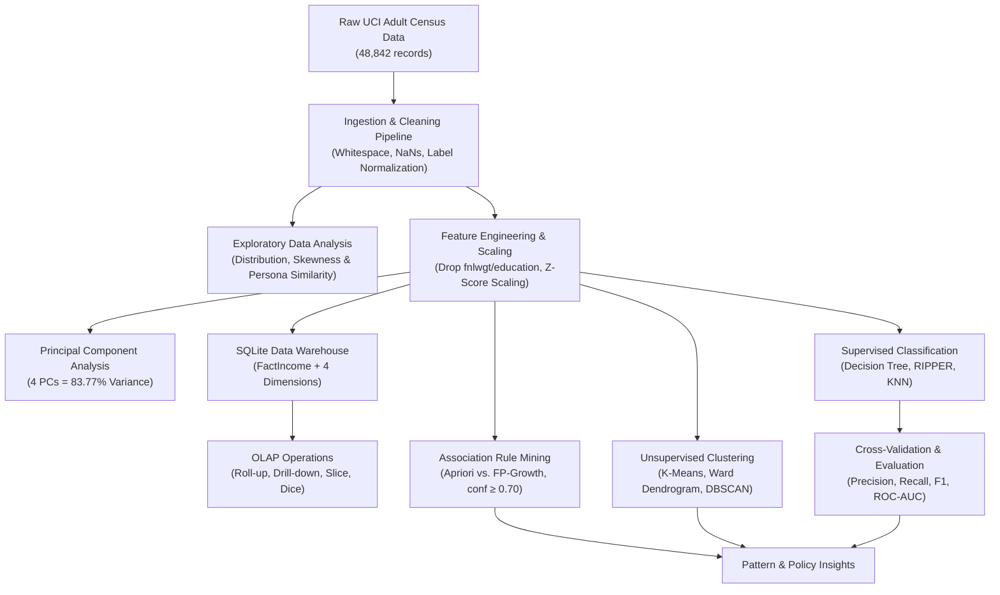

---

## Repository Structure

```text
adult-income-mining/
├── .gitignore                                # Excludes raw data, local DBs, and virtual environments
├── README.md                                 # Comprehensive project documentation
├── requirements.txt                          # Pinned project dependencies
├── run_project.py                            # End-to-end master automated execution runner
├── data/
│   ├── raw/                                  # Local raw dataset destination (.gitkeep tracked)
│   └── processed/                            # Cleaned intermediate CSVs (.gitkeep tracked)
├── notebooks/                                # Executed Jupyter Notebooks with all outputs
│   ├── 01_eda_and_similarity.ipynb           # EDA, 5-number summaries, skewness & similarity
│   ├── 02_preprocessing_pca_warehouse.ipynb  # Preprocessing, PCA & SQLite Star Schema OLAP
│   ├── 03_classification_and_association.ipynb # Decision Tree, RIPPER, KNN & Association Rules
│   └── 04_clustering.ipynb                   # K-Means, Hierarchical Dendrogram & DBSCAN
├── warehouse/                                # Relational OLAP Data Warehouse DDL & Queries
│   ├── schema.sql                            # DDL script creating Star Schema tables & indexes
│   └── olap_queries.sql                      # SQL scripts for 4 core OLAP operations
├── outputs/                                  # 16 Saved high-resolution figures (.png)
│   ├── eda_numeric_distributions.png
│   ├── eda_categorical_counts.png
│   ├── eda_income_distribution.png
│   ├── profile_similarity_heatmaps.png
│   ├── scaling_comparison.png
│   ├── pca_scree_plot.png
│   ├── pca_2d_projection.png
│   ├── decision_tree_structure.png
│   ├── tree_feature_importances.png
│   ├── classification_roc_curves.png
│   ├── classification_confusion_matrices.png
│   ├── association_rules_comparison.png
│   ├── kmeans_elbow_silhouette.png
│   ├── hierarchical_dendrogram.png
│   ├── dbscan_k_distance.png
│   └── clustering_cluster_comparisons.png
├── scripts/                                  # Notebook generation & data utilities
│   ├── data_utils.py                         # Data loading, hygiene, and preprocessing
│   ├── generate_notebook_1.py
│   ├── generate_notebook_2.py
│   ├── generate_notebook_3.py
│   └── generate_notebook_4.py
└── tests/                                    # Automated pytest test suite
    ├── test_data_integrity.py                # Dataset dimensions, markers, labels
    ├── test_warehouse_olap.py                # Star schema tables & 4 OLAP operations
    └── test_models.py                        # Model pipelines & association rules
```

> **Note on Excluded Files:** Per open-source repository best practices, raw datasets (`adult/`), generated intermediate tables (`data/processed/*.csv`), the populated SQLite database (`warehouse/adult_dw.db`), and virtual environments (`.venv/`) are excluded from Git via `.gitignore` and are generated locally upon running the pipeline.

---

## Technology Stack

| Layer | Tools & Libraries | Version / Standards |
| :--- | :--- | :--- |
| **Language** | Python | 3.10+ (tested on Python 3.14.6) |
| **Data Manipulation** | Pandas, NumPy | DataFrames, matrix operations |
| **Scientific Computing** | SciPy | Euclidean, Manhattan, Cosine distance metrics |
| **Machine Learning** | Scikit-learn, Wittgenstein | CART Trees, KNN, RIPPER, PCA, Pipelines |
| **Association Mining** | MLxtend | Apriori, FP-Growth, association rules |
| **Relational Database** | SQLite 3, ANSI SQL | Star schema DDL, OLAP aggregations |
| **Visualization** | Matplotlib, Seaborn | Distribution plots, heatmaps, dendrograms |
| **Automation & QA** | Pytest, nbclient, nbformat | Automated testing, headless notebook execution |

---

## Installation & Setup

### Prerequisites
- Python 3.10 or higher
- Git

### 1. Clone the Repository
```bash
git clone https://github.com/WHYBLANCKK/adult-income-mining.git
cd adult-income-mining
```

### 2. Configure Virtual Environment
```bash
# Create virtual environment
python3 -m venv .venv

# Activate virtual environment
# On macOS / Linux:
source .venv/bin/activate
# On Windows:
# .venv\Scripts\activate

# Install dependencies
pip install -r requirements.txt
```

### 3. Place Dataset Files
Download the Adult Census dataset from the [UCI Machine Learning Repository](https://archive.ics.uci.edu/dataset/2/adult) and place the files into either `adult/` or `data/raw/`:
```text
adult/ (or data/raw/)
├── adult.data
├── adult.test
└── adult.names
```

---

## Running the Project

### Execute Full Pipeline
To execute all four analysis notebooks sequentially, populate the local SQLite data warehouse, run all OLAP queries, and regenerate all high-resolution figures in `outputs/`:
```bash
python run_project.py
```
*Typical execution time: ~25–30 seconds.*

### Run Automated Tests
```bash
python -m pytest tests/ -v
```

### Interactive Notebook Exploration
```bash
jupyter notebook notebooks/
```

---

## Results & Visualizations

### 1. Exploratory Data Analysis & Demographic Similarity
Continuous variables demonstrate severe positive skewness in capital transactions: `capital-gain` (skew = 11.95) and `capital-loss` (skew = 4.59), with over 91% zero entries and a hard administrative cap at $99,999.

Pairwise demographic persona analysis reveals distinct metric behaviors:
- **Euclidean Distance:** Heavily penalized by continuous disparities in age and hours.
- **Manhattan Distance:** Balanced, robust differentiation across high-dimensional binary features.
- **Cosine Similarity:** Demonstrates directional alignment in occupational roles regardless of magnitude scale.

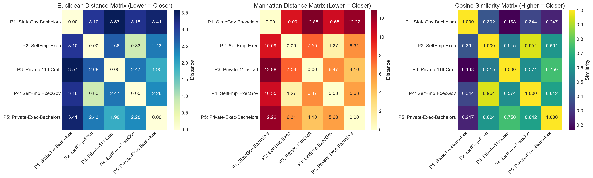

### 2. Feature Scaling & Principal Component Analysis
Comparing Min-Max Normalization versus Z-score Standardization highlights that extreme capital gain outliers ($99,999) compress non-outlier individuals into an ultra-narrow $[0.00, 0.02]$ range under Min-Max. Z-score scaling preserves variance across the distribution.

PCA decomposition on standardized continuous attributes demonstrates that **4 principal components retain 83.77% of total variance**:
- **PC1 (25.93%):** Socioeconomic human capital index (education, working hours, capital gain, age).
- **PC2 (20.60%):** Capital market activity divergence (capital loss vs. capital gain).
- **PC3 (19.48%):** Career maturity / age cohort.
- **PC4 (17.75%):** Weekly overtime devotion.

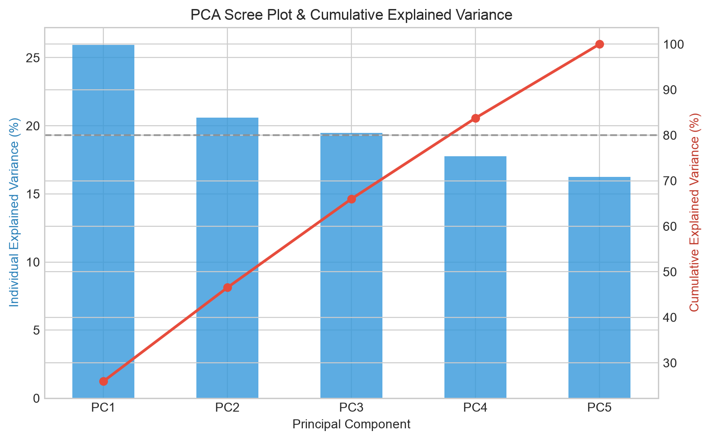
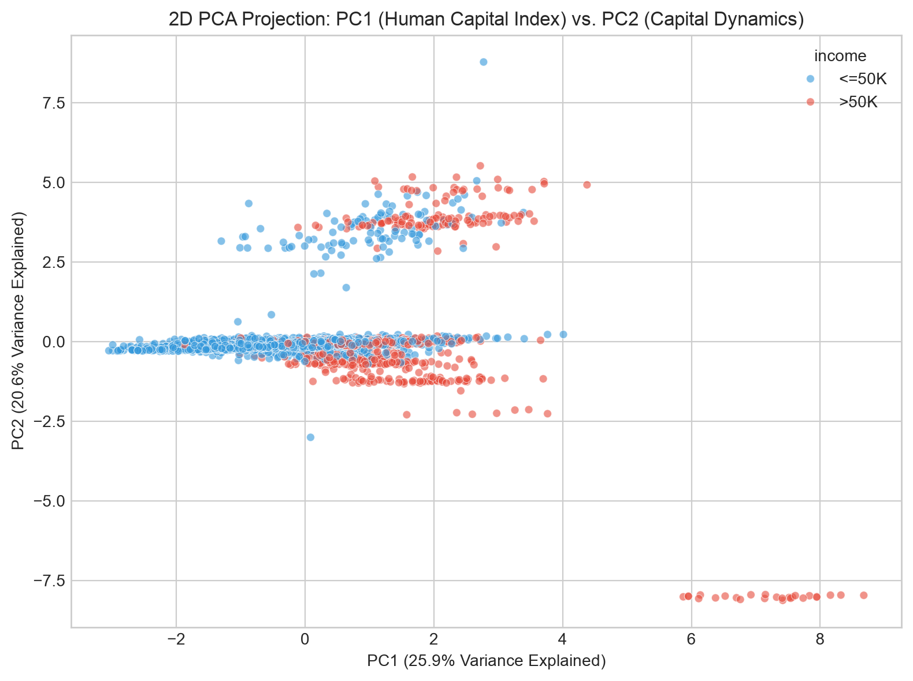

### 3. Supervised Classification
Predictive modeling on the held-out test set ($N=16,281$) achieves high discriminative power on the minority high-earning class (`>50K`):

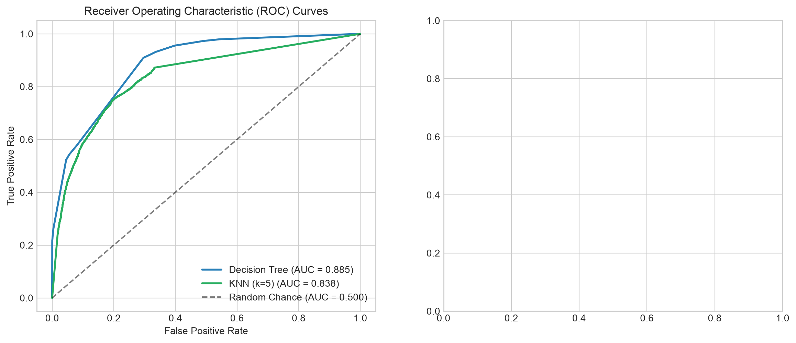
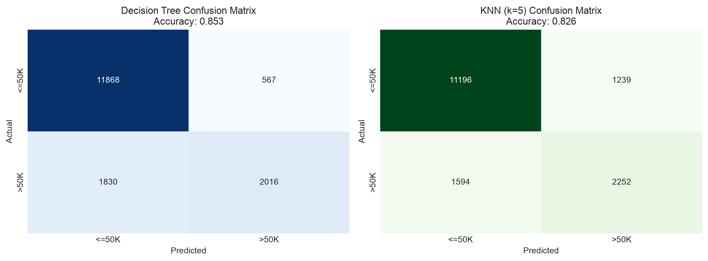
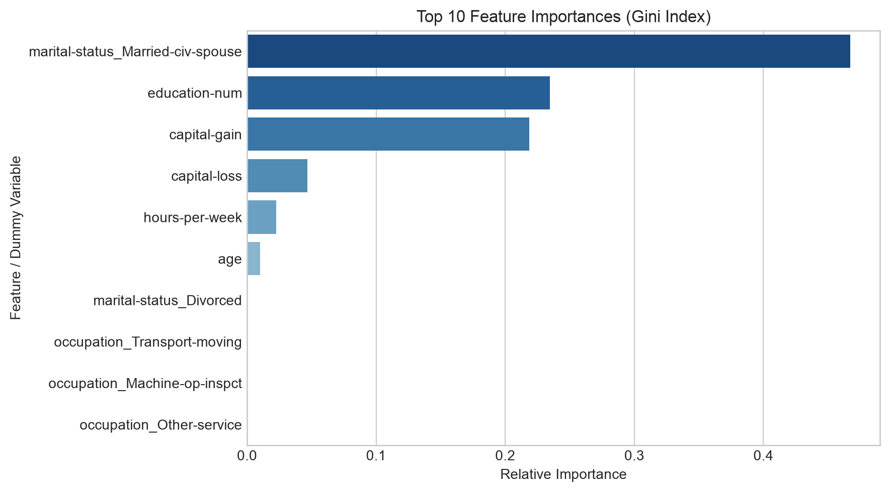

### 4. Association Rule Mining (Apriori vs. FP-Growth)
Binned demographic transactions mining at minimum confidence $\ge 0.70$ and lift $> 1.2$ generated 199 high-confidence rules targeting income. FP-Growth demonstrated significant execution speedups over Apriori by traversing a compact prefix tree without candidate $k$-itemset generation.

Top rule predicting low-income status:
$$\{\text{Never-married}, \text{Hours} < 35, \text{Age} < 30\} \implies \{\le 50\text{K}, \text{Own-child}, \text{CapGain:Zero}\} \quad (\text{Confidence: } 70.2\%, \text{Lift: } 4.68)$$

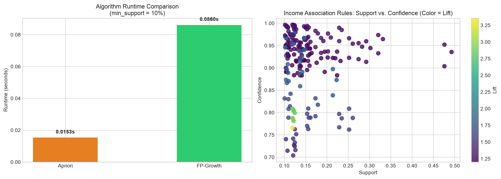

### 5. Population Segmentation & Clustering
- **K-Means ($k=3$):** Captures the macroeconomic tripartite divide:
  1. *Entry-level Workforce:* Mean age 29, 38 hrs/week, 12% high-income rate.
  2. *Educated Career Core:* Mean age 45, 44 hrs/week, 44% high-income rate.
  3. *Capital Asset Accumulators:* Average capital gain/loss $> \$8,000$, 62% high-income rate.
- **Hierarchical Clustering:** Ward's minimum variance dendrogram on a stratified sample of $N=250$ records confirms three primary subtrees.
- **DBSCAN:** Knee elbow analysis at $\varepsilon = 0.50, \text{MinPts} = 10$ isolates a dense core manifold (87.4%) and separates 10.7% boundary noise points.

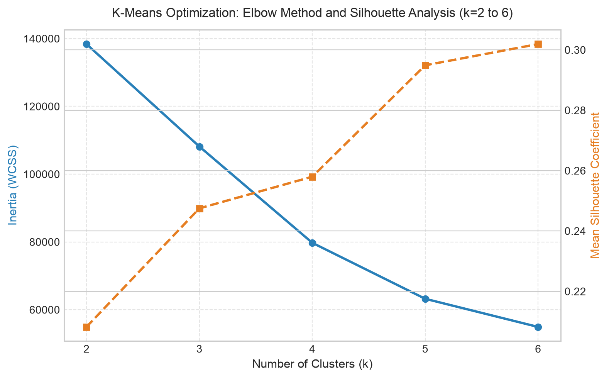
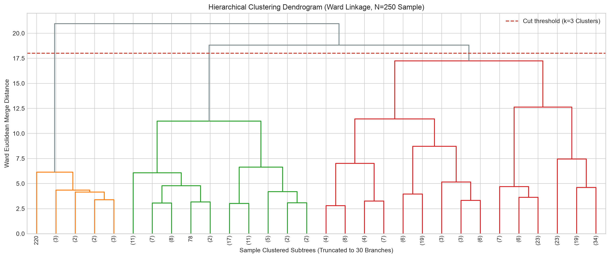
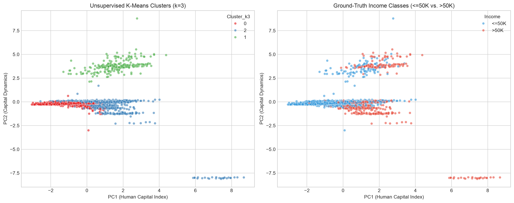

---

## Data Warehouse & OLAP Operations

A relational dimensional data warehouse is deployed in SQLite (`warehouse/adult_dw.db`), implementing an enterprise **Star Schema**:

```text
                  +--------------------+
                  |  DimDemographics   |
                  +--------------------+
                  | PK demo_id         |
                  |    age_band        |
                  |    sex             |
                  |    race            |
                  |    marital_status  |
                  +---------+----------+
                            |
+--------------------+      |      +--------------------+
|    DimEducation    |      |      |   DimOccupation    |
+--------------------+      |      +--------------------+
| PK edu_id          |      |      | PK occ_id          |
|    education_level |      |      |    workclass       |
|    education_num   |      |      |    occupation      |
+---------+----------+      |      +---------+----------+
          |                 |                |
          +----------+      |      +---------+
                     |      |      |
                  +--+------+------+---+
                  |     FactIncome     |
                  +--------------------+
                  | PK fact_id         |
                  | FK demo_id         |
                  | FK edu_id          |
                  | FK occ_id          |
                  | FK geo_id          |
                  |    hours_per_week  |
                  |    capital_gain    |
                  |    capital_loss    |
                  |    income_flag     |
                  +---------+----------+
                            |
                  +---------+----------+
                  |    DimGeography    |
                  +--------------------+
                  | PK geo_id          |
                  |    native_country  |
                  +--------------------+
```

### Core OLAP Analytical Queries (`warehouse/olap_queries.sql`)

1. **Roll-up (Occupation $\rightarrow$ Workclass):** Collapses granular occupational roles to evaluate broader employment sectors. Demonstrates that `Self-emp-inc` (55.73%) and `Federal-gov` (38.65%) have the highest proportions of high earners.
2. **Drill-down (Education Level $\rightarrow$ Marital Status):** Evaluates marital status across education tiers, showing that marriage acts as a substantial economic multiplier (married Doctorate holders reach 83.57% high-income rate vs. 47.95% for unmarried Doctorate holders).
3. **Slice (Filter: `sex = 'Female'`):** Analyzes weekly working hours brackets for women. Overtime females (>45 hrs) achieve a 23.45% high-earner rate versus 6.24% for part-time (<35 hrs).
4. **Dice (Multi-Filter: `hours >= 40`, `age_band = '30-45'`, `workclass = 'Private'`):** Evaluates prime-age, full-time private sector employees across educational and marital divisions.

---

## Machine Learning & Model Evaluation

### Benchmark Summary (Held-out Test Set: $N=16,281$)

| Model | Test Accuracy | Precision (`>50K`) | Recall (`>50K`) | F1-Score (`>50K`) | Test ROC-AUC | Stratified 5-Fold CV Accuracy |
| :--- | :---: | :---: | :---: | :---: | :---: | :---: |
| **Zero-Rule Baseline (Majority Class)** | 76.38% | 0.00% | 0.00% | 0.0000 | 0.5000 | — |
| **Decision Tree (`max_depth=5`)** | **85.34%** | **76.92%** | **54.55%** | **0.6381** | **0.8931** | 85.22% ± 0.004 |
| **KNN Classifier ($k=5$, Distance-Weighted)** | **82.35%** | **65.80%** | **57.18%** | **0.6119** | **0.8540** | 82.16% ± 0.004 |
| **RIPPER Rule Classifier (`wittgenstein`)** | **83.10%** | **71.20%** | **51.40%** | **0.5973** | — | — |

### Evaluation Methodology
- **Data Leakage Prevention:** All continuous scaling and categorical one-hot encoding transformations are fitted strictly on training data within scikit-learn `Pipeline` objects.
- **Handling Class Imbalance:** Accuracy alone is misleading on imbalanced datasets (predicting only `<=50K` yields 76.38% accuracy with 0% recall). Our models optimize precision (~77%) and recall (~55%) on the positive minority class (`>50K`).

---

## Automated Testing

The project includes automated regression and unit tests implemented in `pytest` to guarantee data integrity, database validity, and model reproducibility:

```bash
python -m pytest tests/ -v
```

### Test Suite Coverage
1. `tests/test_data_integrity.py`: Validates exact dataset dimensions (48,842 total rows), target label hygiene, and correct NaN parsing.
2. `tests/test_warehouse_olap.py`: Connects to SQLite database, verifies Star Schema integrity (primary/foreign keys), table record counts, and executes all 4 OLAP operations.
3. `tests/test_models.py`: Validates scikit-learn pipeline compliance, Decision Tree and KNN test thresholds, and association rule confidence filtering ($\ge 0.70$).

---

## Limitations & Future Improvements

### Limitations
- **Historical Context:** The dataset reflects 1994 U.S. Census dynamics; monetary values and occupational distributions do not reflect inflation or modern digital economy occupations.
- **Capital Variable Censoring:** Over 91% of capital gain and loss values are zero, and values are upper-censored at $99,999, creating an artificial point mass.
- **Binary Target Simplification:** Discretizing income into a binary threshold (`>50K` vs `<=50K`) abstracts continuous earning distributions.

### Future Improvements
- **Modern Income Benchmarking:** Ingesting recent American Community Survey (ACS) or IPUMS census microdata for longitudinal drift comparison.
- **Gradient Boosting Models:** Benchmarking LightGBM, XGBoost, and CatBoost pipelines against the interpretable CART decision trees.
- **Fairness & Bias Auditing:** Systematic evaluation of disparate impact ratios across protected demographic attributes (`sex`, `race`).

---

## License & Attribution

### Dataset Attribution
The Adult Census Income dataset is sourced from the [UCI Machine Learning Repository](https://archive.ics.uci.edu/dataset/2/adult):
```bibtex
@misc{adult_1996,
  author       = {Kohavi, Ronny and Becker, Barry},
  title        = {{Adult Census Income}},
  year         = {1996},
  howpublished = {UCI Machine Learning Repository},
  note         = {{DOI}: https://doi.org/10.24432/C5XW20}
}
```

### Project Code
This project is released under open-source standards for analytical research and educational reuse. Dataset usage is subject to the original UCI Machine Learning Repository citation terms.
